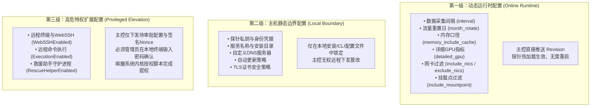

> **Fork 声明**
>
> 本仓库是 [komari-monitor/komari-agent](https://github.com/komari-monitor/komari-agent) 的 Fork，主要用于个人使用、部署、测试和定制。
>
> 本仓库**并非上游项目的官方仓库**，此处所做的修改不应视为上游项目的一部分。
>
> 如需了解官方项目、文档、版本发布及相关支持，请以[komari-monitor/komari-agent]为准。
>
> 上游项目的版权、许可证及贡献者署名均保持不变。

# Komari Agent

Komari Agent 是面向现代跨平台基础设施的监控与远程运维探针，支持 Linux、macOS、Windows 与 Docker。探针基于 **Connect-RPC / Protobuf / HTTP/2** 构建主干通信，具备零信任安全注册、双向流式指标上报、三级分级配置治理与严格的内核级特权控制体系。

---

## 一、 快速安装与部署

探针默认遵循**最小权限原则（Zero-Trust Default-Deny）**：Linux 下以系统专用非登录账号 `komari` 运行，macOS 下以隐藏服务账号 `_komari` 运行，Windows 下以受限 `LocalService` 服务运行。首次部署时远程控制（WebSSH / 远程执行）默认完全关闭。

### 1. Linux 一键安装

```bash
# 默认安全安装（非 root 账号 komari 运行）
curl -fsSL 'https://raw.githubusercontent.com/r11234567/komari-agent/main/install.sh' | sudo bash

# 指定面板地址并以零信任交互方式完成注册（推荐）
curl -fsSL 'https://raw.githubusercontent.com/r11234567/komari-agent/main/install.sh' | sudo bash -s -- -e "https://panel.example.com"
```

### 2. Windows 管理员 PowerShell 安装

```powershell
$script = irm 'https://raw.githubusercontent.com/r11234567/komari-agent/main/install.ps1'
& ([scriptblock]::Create($script)) -e "https://panel.example.com"
```

### 3. Docker 容器安装

```bash
docker run -d \
  --name komari-agent \
  --restart unless-stopped \
  --cap-add NET_RAW \
  -e AGENT_ENDPOINT="https://panel.example.com" \
  -e AGENT_TOKEN="your-agent-token" \
  ghcr.io/r11234567/komari-agent:latest
```

---

## 二、 零信任节点入网注册（Tailscale 风格）

探针支持完全无需在命令行传递静态明文 Token 的零信任注册交互：

1. 探针安装完成后，在终端执行注册命令：
   ```bash
   komari-agent login --endpoint "https://panel.example.com"
   ```
2. 探针会在终端输出一个专属的一次性设备授权链接与验证码：
   ```text
   Open this URL in your browser to approve this machine:
   https://panel.example.com/nodes/claim?token=claim-xxxxxxxxxxxx
   ```
3. 管理员在浏览器打开链接并确认添加节点。
4. 探针与主控完成双向 Ed25519 秘钥交换与 DPoP 签名绑定，凭据落盘于 `/opt/komari/credentials.json`（权限 0600）。
5. 注册成功后启动或重启探针服务即可正常上报：
   ```bash
   sudo systemctl restart komari-agent
   ```

---

## 三、 配置与参数说明

参数可通过命令行参数、环境变量或 JSON 配置文件传入。优先级由低到高为：**默认值 < 命令行参数 < 环境变量 < JSON 配置文件**。

### 常用核心参数一览表

| 命令行参数 | 环境变量 | JSON 字段 | 说明 |
| :--- | :--- | :--- | :--- |
| `--endpoint`, `-e` | `AGENT_ENDPOINT` | `endpoint` | 面板地址 |
| `--token`, `-t` | `AGENT_TOKEN` | `token` | 探针接入 Token（零信任模式下由 login 命令管理） |
| `--interval`, `-i` | `AGENT_INTERVAL` | `interval` | 指标采集间隔（秒），支持在线动态下发（1~3600） |
| `--disable-remote-control` | `AGENT_DISABLE_REMOTE_CONTROL` | `disable_remote_control` | 禁用远程终端（WebSSH）与远程命令执行 |
| `--disable-auto-update` | `AGENT_DISABLE_AUTO_UPDATE` | `disable_auto_update` | 禁用自动更新 |
| `--ignore-unsafe-cert`, `-u` | `AGENT_IGNORE_UNSAFE_CERT` | `ignore_unsafe_cert` | 忽略 TLS 证书校验错误（测试/自签名环境） |
| `--memory-include-cache` | `AGENT_MEMORY_INCLUDE_CACHE` | `memory_include_cache` | 内存占用计算口径包含系统 Cache/Buffer，支持在线下发 |
| `--enable-gpu` | `AGENT_ENABLE_GPU` | `enable_gpu` | 启用基础 GPU 监控 |
| `--detailed-gpu` | `AGENT_DETAILED_GPU` | `detailed_gpu` | 启用详细 GPU 指标监控（功耗、温度、风扇），支持在线下发 |
| `--include-nics` | `AGENT_INCLUDE_NICS` | `include_nics` | 仅监控指定网卡（逗号分隔），支持在线下发 |
| `--exclude-nics` | `AGENT_EXCLUDE_NICS` | `exclude_nics` | 监控排除网卡（逗号分隔），支持在线下发 |
| `--include-mountpoint` | `AGENT_INCLUDE_MOUNTPOINTS` | `include_mountpoints` | 磁盘监控挂载点过滤（分号分隔），支持在线下发 |
| `--month-rotate` | `AGENT_MONTH_ROTATE` | `month_rotate` | 流量统计每月重置日（0 为禁用，1~31），支持在线下发 |
| `--custom-dns` | `AGENT_CUSTOM_DNS` | `custom_dns` | 自定义 DNS 服务器（如 `8.8.8.8`） |
| `--prefer-ip-version` | `AGENT_PREFER_IP_VERSION` | `prefer_ip_version` | 面板连接优先使用的 IP 版本（`4` 或 `6`） |
| `--cf-access-client-id` | `AGENT_CF_ACCESS_CLIENT_ID` | `cf_access_client_id` | Cloudflare Access 服务令牌 Client ID（须与 Secret 配对） |
| `--cf-access-client-secret` | `AGENT_CF_ACCESS_CLIENT_SECRET` | `cf_access_client_secret` | Cloudflare Access 服务令牌 Client Secret |
| `--reconnect-interval`, `-c` | `AGENT_RECONNECT_INTERVAL` | `reconnect_interval` | 断线重连基础间隔（秒），内部具备带抖动的指数退避 |
| `--info-report-interval` | `AGENT_INFO_REPORT_INTERVAL` | `info_report_interval` | 静态硬件/系统信息全量上报周期（分钟） |

> **提示**：旧版冗余及已弃用参数（如 `--disable-web-ssh`、`--gpu`、`--memory-exclude-bcf`、`-autoUpdate`）已全面清理剔除，请使用上述标准参数。

---

## 四、 探针配置三级分级治理体系

为了防止“主控攻陷导致全集群失陷”，Komari 严格实施三级配置隔离模型：



---

## 五、 特权守护进程提权与降级机制（核心安全）

探针在普通用户（非 root）下运行时，**任何远程控制与终端执行均处于硬件/系统隔离的关闭状态**。当主控下发包含特权扩展（如开启 WebSSH）的任务时，探针必须经过物理机/SSH 终端的人机交互内核认证：

### 1. 提权限制与防篡改条件
唤醒预留的提权脚本 `komari-elevate`（或 `/opt/komari/elevate.sh`）必须同时满足以下刚性安全准则：
1. **下发过合法配置**：主控已对特权 Revision 进行了 Ed25519 签名分发，本地 `privileged.json` 中存在对应的未过期 Pending 任务和随机 Nonce。
2. **强制内核/系统级授权**：**密码绝不经过探针二进制程序内存**！通过操作系统 PAM / sudo / Windows UAC 强制弹出交互式密码输入框。
3. **绕过 sudo 免密与内核留痕**：脚本在验证前强制执行 `sudo -k` 作废凭据缓存；若系统配置了 `NOPASSWD` 或当前已处于 root，脚本仍强制要求输入 root/管理员密码，并将授权事件直接写入 Linux 内核环形缓冲区 `/dev/kmsg` 及 `authpriv` 系统日志。
4. **服务重写与提权生效**：将 systemd 守护进程单元重写为 `User=root`，重载系统服务，向主控兑现 Nonce 证明完成升级。

### 2. 管理员执行提权操作

在受管服务器终端运行提权命令：

```bash
# 方式 A：通过探针 CLI 唤醒提权
komari-agent upgrade

# 方式 B：直接调用系统保留提权脚本
sudo komari-elevate promote --revision <REV> --nonce <NONCE>
```

终端将弹出内核授权安全提示：
```text
=================================================================
  [Komari Security Gateway] Kernel Privilege Elevation Request   
=================================================================
  Target Service:  komari-agent
  Target Revision: 2
  Target Nonce:    a1b2c3d4e5f6...
  Operator:        admin
=================================================================
Enter [root] password to authorize kernel elevation: 
[SECURITY AUDIT] Kernel authorization verified. Logged to /dev/kmsg and syslog.
[INFO] Updating systemd service 'komari-agent' to root...
[SUCCESS] Service komari-agent successfully elevated to root and running.
```

### 3. 一键平滑降级（切回非 root）

撤销特权配置是安全的防御性操作，无需重复输入密码：

```bash
# 通过脚本一键降级回 komari 非特权账号运行
sudo komari-elevate demote
```
系统守护进程将立即恢复为 `User=komari`，强制禁用所有远程控制指令并重启服务。

---

## 六、 完整卸载指南

### 1. Linux / macOS 卸载

```bash
# 方式 A：使用一键卸载脚本（推荐）
sudo komari-uninstall

# 方式 B：使用安装脚本的卸载参数
curl -fsSL 'https://raw.githubusercontent.com/r11234567/komari-agent/main/install.sh' | sudo bash -s -- --uninstall

# 彻底清理（包括删除 komari 服务专用账号）
sudo /opt/komari/uninstall.sh --purge-user
```

### 2. Windows 卸载

以管理员身份打开 PowerShell：

```powershell
# 使用安装目录卸载
& "$env:ProgramFiles\Komari\install.ps1" --uninstall

# 或通过网络一键卸载
$script = irm 'https://raw.githubusercontent.com/r11234567/komari-agent/main/install.ps1'
& ([scriptblock]::Create($script)) '--uninstall'
```

### 3. Docker 卸载

```bash
docker rm -f komari-agent
docker volume rm komari-agent-data
docker image rm ghcr.io/r11234567/komari-agent:latest
```

---

## 七、 技术主干与网络特性

- **HTTP/2 & h2c 多路复用**：全面支持 TLS 及内网明文 h2c，AttachSession 终端双向流、Metrics 批次上报流与 Unary 请求在同一条持久 TCP 连接上多路复用，彻底规避 HTTP/1.1 长连接池饿死问题。
- **平滑指数退避重连**：当主控服务重启或网络发生瞬时断连时，探针严格使用带随机抖动的指数退避重连，严禁守护进程异常退出，杜绝重连风暴。
- **硬件级监控**：内存占用精细化识别（支持 Buffer/Cache 隔离计算），集成 Linux proc/sysfs、macOS host_statistics、Windows WMI/Pdh 及全平台 GPU 监控。
