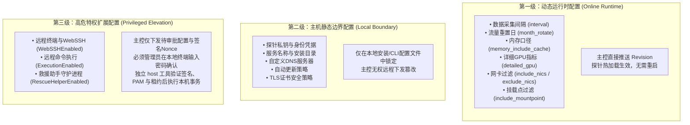

> **Fork 声明**
>
> 本仓库是 [komari-monitor/komari-agent](https://github.com/komari-monitor/komari-agent) 的 Fork，主要用于个人使用、部署、测试和定制。
>
> 本仓库**并非上游项目的官方仓库**，此处所做的修改不应视为上游项目的一部分。
>
> 如需了解官方项目、文档、版本发布及相关支持，请以[komari-monitor/komari-agent]为准。
>
> 上游项目的版权、许可证及贡献者署名均保持不变。

# Komari Agent

Komari Agent 是面向现代跨平台基础设施的监控与远程运维探针，支持 Linux、macOS、Windows 与 Docker。探针基于 **Connect-RPC / Protobuf / HTTP/2** 构建主干通信，具备零信任安全注册、双向流式指标上报、三级分级配置治理与严格的内核级特权控制体系。

---

## 一、 快速安装与部署

探针默认遵循**最小权限原则（Zero-Trust Default-Deny）**：Linux 下以系统专用非登录账号 `komari` 运行，macOS 下以隐藏服务账号 `_komari` 运行，Windows 下以受限 `LocalService` 服务运行。首次部署时远程控制（WebSSH / 远程执行）默认完全关闭。

### 1. Linux 一键安装

```bash
# 默认安全安装（非 root 账号 komari 运行）
curl -fsSL 'https://raw.githubusercontent.com/r11234567/komari-agent/main/install.sh' | sudo bash

# 指定面板地址；安装后按提示执行 login 完成注册
curl -fsSL 'https://raw.githubusercontent.com/r11234567/komari-agent/main/install.sh' | sudo bash -s -- -e "https://panel.example.com"
```

### 2. Windows 管理员 PowerShell 安装

```powershell
$script = irm 'https://raw.githubusercontent.com/r11234567/komari-agent/main/install.ps1'
& ([scriptblock]::Create($script)) -e "https://panel.example.com"
```

### 3. macOS 安装

```bash
curl -fsSL 'https://raw.githubusercontent.com/r11234567/komari-agent/main/install.sh' | sudo bash -s -- -e "https://panel.example.com"
sudo -u _komari /usr/local/komari/agent login --endpoint "https://panel.example.com"
sudo launchctl kickstart -k system/com.komari.komari-agent
```

### 4. Docker 容器安装

```bash
docker run -d \
  --name komari-agent \
  --restart unless-stopped \
  --cap-add NET_RAW \
  -e AGENT_ENDPOINT="https://panel.example.com" \
  -e AGENT_TOKEN="your-agent-token" \
  ghcr.io/r11234567/komari-agent:latest
```

---

## 二、 零信任节点入网注册（Tailscale 风格）

探针支持完全无需在命令行传递静态明文 Token 的零信任注册交互：

1. 探针安装完成后，使用安装器提示的命令注册。Linux 默认安装应以服务账号运行：
   ```bash
   sudo -u komari /opt/komari/agent login --endpoint "https://panel.example.com"
   ```
2. 探针会在终端输出一个专属的一次性设备授权链接与验证码：
   ```text
   Open this URL in your browser to approve this machine:
   https://panel.example.com/nodes/claim?token=claim-xxxxxxxxxxxx
   ```
3. 管理员在浏览器打开链接并确认添加节点。
4. 探针生成本机 Ed25519 密钥，并保存与密钥绑定的凭据，后续通过 DPoP 证明身份。Linux 默认凭据位于 `/opt/komari/credentials.json`（权限 0600，所有者 `komari`）。
5. 注册成功后启动或重启探针服务即可正常上报：
   ```bash
   sudo systemctl reset-failed komari-agent
   sudo systemctl restart komari-agent
   ```

安装器在可执行文件旁写入不含密钥的 `service-config.json`。服务与 `login`、`status`、`refresh`、`trust`、`config show` 等 CLI 命令由此使用相同的凭据、运行配置、特权状态和防重放记录路径，不再依赖启动账号的 HOME/APPDATA。显式路径参数和环境变量仍可覆盖这些默认值。单独下载、没有此文件的二进制继续使用用户配置目录。

| 平台（默认安装） | 登录命令 | 凭据文件 | 启动/重启 |
| :--- | :--- | :--- | :--- |
| Linux/systemd | `sudo -u komari /opt/komari/agent login --endpoint <面板地址>` | `/opt/komari/credentials.json` | `sudo systemctl restart komari-agent` |
| macOS/launchd | `sudo -u _komari /usr/local/komari/agent login --endpoint <面板地址>` | `/usr/local/komari/credentials.json` | `sudo launchctl kickstart -k system/com.komari.komari-agent` |
| Windows/NSSM | 管理员 PowerShell：`& "$env:ProgramFiles\Komari\komari-agent.exe" login --endpoint <面板地址>` | `%ProgramData%\Komari\credentials.json` | 管理员 PowerShell：`Restart-Service komari-agent` |

Linux/macOS 使用安装器创建的服务账号写入凭据，避免 root 登录后生成服务账号无法读取的 0600 文件。Windows 凭据目录通过 ACL 向 SYSTEM、Administrators 和 LocalService 授权。Windows 的特权状态默认放在安装目录的 `privileged.json`，与提权脚本保持一致；其余状态放在 ProgramData。

未注册时，systemd 和 Windows 安装器仅启用自动启动，等待登录后再启动；launchd 加载任务后等待注册。安装器不会把尚未注册视为成功在线。详细诊断和旧版本迁移见 [守护进程启动排查](docs/service-startup.md)。

---

## 三、 配置与参数说明

本机连接和服务定位参数可通过命令行、环境变量或 JSON 配置文件传入，优先级为：**默认值 < 命令行参数 < 环境变量 < JSON 配置文件**。`disable-remote-control` 是本机否决：任一本机来源为 true 即禁用，在线批准不能解除。可在线下发的监控与特权字段已从公开 CLI、环境变量和普通 JSON 输入删除。历史字段只由管理员的受保护迁移配置读取。

### 常用核心参数一览表

| 命令行参数 | 环境变量 | JSON 字段 | 说明 |
| :--- | :--- | :--- | :--- |
| `--endpoint`, `-e` | `AGENT_ENDPOINT` | `endpoint` | 面板地址 |
| `--token`, `-t` | `AGENT_TOKEN` | `token` | 探针接入 Token（零信任模式下由 login 命令管理） |
| `--disable-remote-control` | `AGENT_DISABLE_REMOTE_CONTROL` | `disable_remote_control` | 禁用远程终端（WebSSH）与远程命令执行 |
| `--disable-auto-update` | `AGENT_DISABLE_AUTO_UPDATE` | `disable_auto_update` | 禁用自动更新 |
| `--ignore-unsafe-cert`, `-u` | `AGENT_IGNORE_UNSAFE_CERT` | `ignore_unsafe_cert` | 忽略 TLS 证书校验错误（测试/自签名环境） |
| `--custom-dns` | `AGENT_CUSTOM_DNS` | `custom_dns` | 自定义 DNS 服务器（如 `8.8.8.8`） |
| `--prefer-ip-version` | `AGENT_PREFER_IP_VERSION` | `prefer_ip_version` | 面板连接优先使用的 IP 版本（`4` 或 `6`） |
| `--cf-access-client-id` | `AGENT_CF_ACCESS_CLIENT_ID` | `cf_access_client_id` | Cloudflare Access 服务令牌 Client ID（须与 Secret 配对） |
| `--cf-access-client-secret` | `AGENT_CF_ACCESS_CLIENT_SECRET` | `cf_access_client_secret` | Cloudflare Access 服务令牌 Client Secret |
| `--reconnect-interval`, `-c` | `AGENT_RECONNECT_INTERVAL` | `reconnect_interval` | 断线重连基础间隔（秒），内部具备带抖动的指数退避 |
| `--info-report-interval` | `AGENT_INFO_REPORT_INTERVAL` | `info_report_interval` | 静态硬件/系统信息全量上报周期（分钟） |

查询本机保存的配置：

```sh
komari-agent config show --json
# 多安装时明确选择服务
komari-agent --service-manifest /etc/komari/services/SERVICE.json config show
```

查询输出标明磁盘来源和时间，不等同于实时 daemon 认证或服务端 desired。`upgrade`、`update-conf`、`rollback`、`status privileged`、`recover show-config` 和 `recover rollback-config` 已删除。旧 unit 的在线参数需先通过管理员迁移工具转换；新安装直接报错。完整清单见 [CLI 迁移说明](docs/privileged-cli-migration-inventory.md)。

---

## 四、 探针配置三级分级治理体系

为了防止“主控攻陷导致全集群失陷”，Komari 严格实施三级配置隔离模型：



---

## 五、 本机特权事务

Linux/systemd 使用独立 root-owned `komari-host` 工具。管理员先核实并固定面板与发布者公钥，安装固定 PAM profile；面板保存并完成新鲜 2FA 批准后，再在本机执行：

```sh
sudo komari-host apply --manifest /etc/komari/services/SERVICE.json --revision N
# 中断后的继续或本地恢复
sudo komari-host resume --manifest /etc/komari/services/SERVICE.json
sudo komari-host restore --manifest /etc/komari/services/SERVICE.json
```

口令由终端直接交给 PAM，daemon、面板、RPC、argv、环境和日志均不携带口令。工具核验签名、agent/service、批准代次、hash、操作集和执行租约后，才修改本机服务。实际 PID/UID、capabilities、NoNewPrivileges 和 helper 观察通过后，还必须由 daemon 独立 ACK；root CLI 运行不等于 daemon 已提权，内核日志也不代替认证。

救援 helper 默认不安装，按需验证发布签名和固定版本 artifact，再执行批准后的独立安装事务。普通 daemon 可继续以普通账号运行。恢复日志保留原文件 UID/GID/mode，异常恢复可在断网时执行，回执恢复联网后重发。

配置步骤、缓存/离线 artifact、支持边界和发布签名要求见 [阶段 6 本机事务说明](docs/privileged-host-stage6.md)。Windows、macOS、FreeBSD 的 host actions 当前明确不支持；不能使用旧 elevation 脚本。

---

## 六、 完整卸载指南

### 1. Linux / macOS 卸载

```bash
# 方式 A：使用一键卸载脚本（推荐）
sudo komari-uninstall

# 方式 B：使用安装脚本的卸载参数
curl -fsSL 'https://raw.githubusercontent.com/r11234567/komari-agent/main/install.sh' | sudo bash -s -- --uninstall

# 彻底清理（包括删除 komari 服务专用账号）
sudo /opt/komari/uninstall.sh --purge-user
```

### 2. Windows 卸载

以管理员身份打开 PowerShell：

```powershell
# 使用安装目录卸载
& "$env:ProgramFiles\Komari\install.ps1" --uninstall

# 或通过网络一键卸载
$script = irm 'https://raw.githubusercontent.com/r11234567/komari-agent/main/install.ps1'
& ([scriptblock]::Create($script)) '--uninstall'
```

### 3. Docker 卸载

```bash
docker rm -f komari-agent
docker volume rm komari-agent-data
docker image rm ghcr.io/r11234567/komari-agent:latest
```

---

## 七、 技术主干与网络特性

- **HTTP/2 & h2c 多路复用**：全面支持 TLS 及内网明文 h2c，AttachSession 终端双向流、Metrics 批次上报流与 Unary 请求在同一条持久 TCP 连接上多路复用，彻底规避 HTTP/1.1 长连接池饿死问题。
- **平滑指数退避重连**：当主控服务重启或网络发生瞬时断连时，探针严格使用带随机抖动的指数退避重连，严禁守护进程异常退出，杜绝重连风暴。
- **硬件级监控**：内存占用精细化识别（支持 Buffer/Cache 隔离计算），集成 Linux proc/sysfs、macOS host_statistics、Windows WMI/Pdh 及全平台 GPU 监控。
